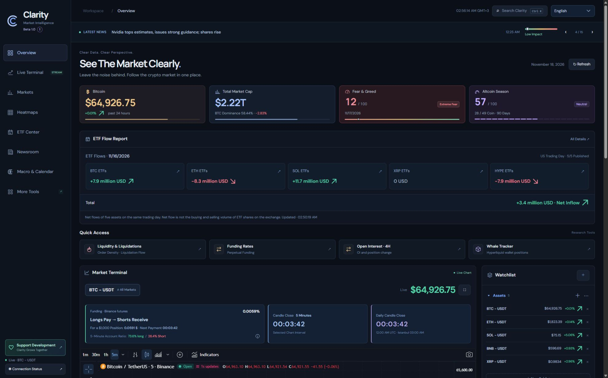

<div align="center">
  
  <h1>Clarity</h1>
  <p><strong>Market Intelligence. Clear Perspective.</strong></p>
  <p>A focused crypto research terminal for live markets, market structure and the global events that move them.</p>
  <p>
    
    
    
    
  </p>
  <p><a href="https://github.com/zekikaynak/Clarity/releases"><strong>↓ Download For Windows</strong></a> &nbsp; · &nbsp; <a href="#-quick-start">Quick Start</a> &nbsp; · &nbsp; <a href="#-inside-clarity">Features</a> &nbsp; · &nbsp; <a href="https://github.com/zekikaynak/Clarity/issues">Report An Issue</a></p>
</div>

---

> **Beta 1.0 · Under Active Development**  
> This release is intended for market research. Features continue to evolve and external data availability can vary.

## ◈ The Market, In One View

Full-screen capture of the English interface. Prices and dates reflect the moment of capture.



## ⌁ Inside Clarity

| | Workspace | What You Can Explore |
| :---: | :--- | :--- |
| 📈 | **Live Terminal** | Streaming candles, the native drawing toolbar, readable volume, candle details and closing countdowns. |
| ◫ | **Market Structure** | Buy and sell depth, real-time trades, large pending levels, funding and available liquidation views. |
| ☆ | **Watchlists** | Coin pairs, dominance and index instruments, named groups and local preferences. |
| ▤ | **ETF Center** | BTC, ETH, SOL, XRP and HYPE flow coverage, daily summaries and source status. |
| ◎ | **News & Macro** | Market headlines, Turkish headline translation, a global economic calendar and crypto importance indicators. |
| ◇ | **Research Tools** | Cycle indicators, on-chain and DeFi views, portfolio tools and alerts, accessible through **More Tools**. |

**Designed To Stay Clear:** a spacious primary menu, a dedicated tools panel, themed dialogs and layouts that adapt to desktop, ultrawide and smaller screens. Turkish and English include their own date, time and number formats.

<details>
<summary><strong>View The English Live Terminal</strong></summary>


</details>

## ▶ Quick Start

1. Download **Clarity-Beta-1.0-Windows.zip** from [GitHub Releases](https://github.com/zekikaynak/Clarity/releases).
2. Extract the complete folder, keeping `app`, `docs` and `runtime` together.
3. Open **Start Clarity.bat**. It checks the required components, starts the local server and opens your default browser.
4. Keep the console open while using Clarity. Press **Ctrl+C** in that console to stop it.

The release includes Node.js and application dependencies. If a required component is missing, setup asks for permission before downloading or installing it. No administrator access is required. An internet connection is needed for market providers and hosted charts.

**Türkçe:** Windows paketini indirin, klasöre çıkartın ve **Start Clarity.bat** dosyasını açın. Gerekli bileşenler kontrol edilir; eksikse kurulum izni istenir. Panel tarayıcıda açılır. Dil menüsünden Türkçe veya İngilizce seçebilirsiniz; Otomatik seçeneği sistem dilini kullanır.

## ↻ Updates That Respect Your Workspace

The BAT checks **published GitHub Releases** at startup. Updates use a versioned manifest, SHA-256 checks, an application backup and interrupted-update recovery. A running session is left untouched until its console is closed and the BAT is reopened.

Personal files and browser storage are not cleared. Use the same browser and address to access existing local records. Hosted TradingView drawings depend on the provider's own save support; drawings it has not saved cannot be exported by Clarity's updater.

**For maintainers:** publishing source commits alone does not distribute an update. Follow the [release publishing guide](https://github.com/zekikaynak/Clarity/blob/main/docs/UPDATES.md) to generate and attach the matching update assets.

## ⌘ Run From Source

Use Node.js **24 or later**. From the `app` directory:

```powershell
npm ci
npm test
npm start
```

The Windows launcher also supports `--check` for local prerequisite checks and `--skip-update` to skip the online update check.

## ◉ Data & Privacy

- The service listens on the local computer. No shared account or cloud synchronization is included.
- Watchlists, settings, portfolio records and alerts are stored in the current browser. Runtime caches remain outside the distribution under LocalAppData/Clarity.
- Public news headlines may be sent for automatic Turkish translation; private workspace records are not submitted for translation.
- Sources have independent coverage, delays and rate limits. Unavailable data is not invented. Large pending orders represent received aggregated depth levels rather than the entire exchange book.
- Clarity does not place trades or connect a wallet. The application includes an optional developer-support dialog.

[Third-Party Notices](https://github.com/zekikaynak/Clarity/blob/main/docs/THIRD_PARTY.md) · [Verification Report](https://github.com/zekikaynak/Clarity/blob/main/docs/TEST-REPORT.md) · [Changelog](https://github.com/zekikaynak/Clarity/blob/main/docs/CHANGELOG.md)

## ⌥ Contributing

Bug reports and focused pull requests are welcome. Include the application version, interface language, screen size and clear reproduction steps. Remove private records, API keys and personal information from screenshots and logs before sharing.

Licensed under [MIT](https://github.com/zekikaynak/Clarity/blob/main/LICENSE). Provider data, trademarks and hosted widgets remain subject to their respective terms.
