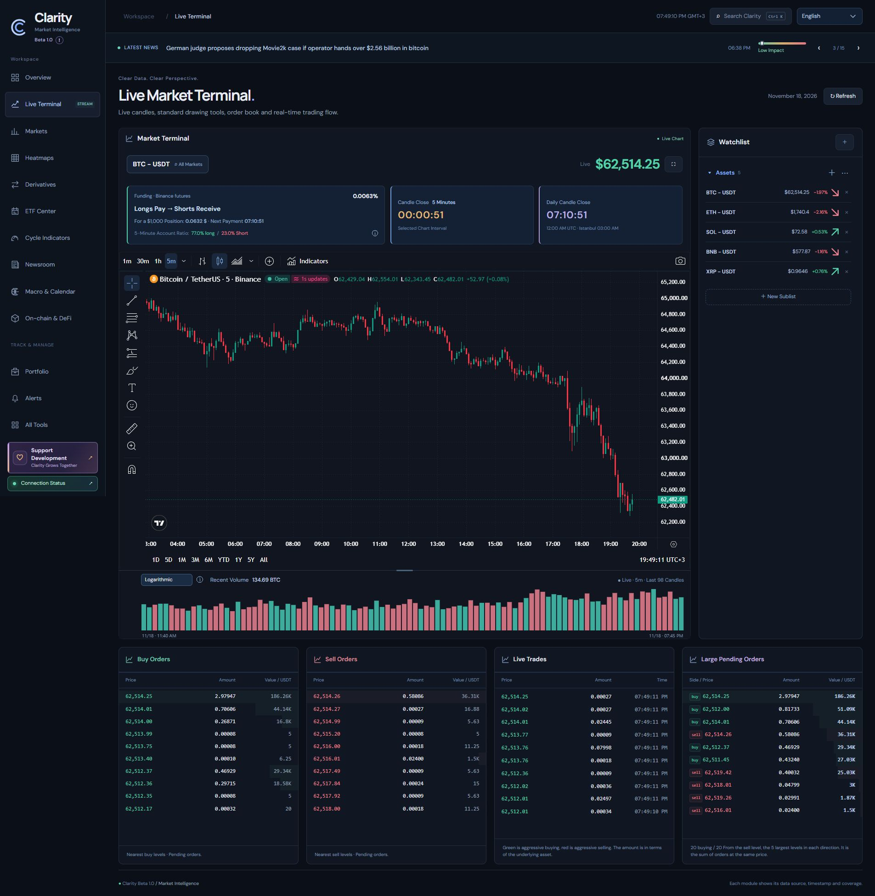

<div align="center">
  
  <h1>Clarity</h1>
  <p><strong>Market Intelligence. Clear Perspective.</strong></p>
  <p>A focused crypto research terminal for live markets, market structure and the global events that move them.</p>
  <p>
    
    
    
    
  </p>
  <p><a href="https://github.com/zekikaynak/Clarity/releases"><strong>Download For Windows</strong></a> &nbsp; · &nbsp; <a href="#quick-start">Quick Start</a> &nbsp; · &nbsp; <a href="#inside-clarity">Features</a> &nbsp; · &nbsp; <a href="https://github.com/zekikaynak/Clarity/issues">Report An Issue</a></p>
</div>

---

> **Beta 1.0 · Under Active Development**  
> This release is intended for market research. Features continue to evolve and external data availability can vary.

## The Market, In One View

Current English overview captured in Update 4. Prices and dates reflect the moment of capture.


## Inside Clarity

Clarity includes the following views and tools. The list below expands the previous six-category summary; data coverage and refresh frequency depend on each source.

| Feature | Available In The Panel |
| :--- | :--- |
| **Market Overview** | Bitcoin, total market capitalization, dominance, Fear & Greed and Altcoin Season summaries. |
| **Live Candlestick Charts** | Multiple intervals, native chart controls, zoom, fullscreen and a drawing toolbar. |
| **Candle & Daily Countdowns** | Time remaining until the selected candle closes and the UTC trading day ends. |
| **Recent Volume** | Logarithmic or linear scaling, a resizable area and remembered display preferences. |
| **Candle Details** | Click a volume bar to inspect its time, open, high, low, close, change and actual volume. |
| **Funding Explained** | Funding rate, payment countdown and a plain-language explanation of which side pays. |
| **Order Book** | Separate bid and ask panels with prices, quantities and quote values. |
| **Real-Time Trades** | Streaming executions with trade direction, amount and timestamp. |
| **Large Pending Orders** | The largest aggregated buy and sell levels within the received depth. |
| **Grouped Watchlists** | Add or remove assets, create named groups and choose group colors. |
| **Dominance & Index Instruments** | A separate instrument category, including BTC and USDT dominance and supported market-cap indices. |
| **Market Explorer** | Search crypto pairs, follow price and volume changes, and keep stablecoins after other assets. |
| **Crypto Heatmap** | Market size and 24-hour price changes in a color-coded market view. |
| **RSI Heatmap** | Compare overbought and oversold readings across available assets. |
| **Liquidity & Liquidation Maps** | Live order density, clearly identified estimated liquidation regions and actual liquidation-flow views. |
| **Derivatives Monitor** | Funding, open interest, changes in positioning and available long/short ratios. |
| **Whale Tracker** | Public Hyperliquid wallet-position coverage. |
| **Five-Asset ETF Center** | BTC, ETH, SOL, XRP and HYPE flows, a combined daily report and individual detail views. |
| **Newsroom & Headline Ribbon** | Market headlines, original article links, Turkish headline translation and visual crypto-importance indicators. |
| **Global Economic Calendar** | Event times, Turkish names, importance, previous/forecast/actual values and separately labeled conditional crypto-impact estimates. Neutral surprise and uncertain impact are distinguished. |
| **Macro Monitor** | Available interest-rate, inflation, money-supply, Treasury-yield and volatility series. |
| **Cycle Compass** | A 30-indicator coverage view with source values and locally calculated technical models. |
| **Bitcoin Research Charts** | 200-week average, Rainbow, Pi Cycle, 2-year MA, Golden Ratio, Puell, MVRV, Reserve Risk, CBBI, NUPL, AHR999 and related reference views. |
| **Monthly Returns** | A Bitcoin monthly-return view calculated from the available daily price history. |
| **On-Chain & DeFi** | Available Bitcoin-network, DeFi and stablecoin-market information. |
| **Portfolio Tracking** | Manual holdings, cost and exchange/wallet labels, valuation, gross profit/loss and record export. |
| **Price Alerts** | Above/below target alerts evaluated while the panel and relevant instrument stream are active. |
| **Connection Status** | Source diagnostics, last-check information, retry timing and reconnection controls. |
| **Turkish & English** | Interface language, native chart language, localized numbers, dates and times. |
| **GitHub Updates** | Startup release checks, integrity verification, application backups and interrupted-update recovery. |

**Direct Navigation:** all thirteen main destinations are listed directly in the sidebar, with compact, readable labels and an adaptive layout for desktop, ultrawide and smaller screens.


## Live Terminal




## Quick Start

### One-Command Install · Windows

Open **PowerShell** (no administrator access needed) and paste:

```powershell
& ([scriptblock]::Create((Invoke-RestMethod 'https://raw.githubusercontent.com/zekikaynak/Clarity/main/docs/install.ps1')))
```

Downloads the most recently published Windows release (including beta), verifies its SHA-256 digest and installs to `%LOCALAPPDATA%\Programs\Clarity`. It then opens **Start Clarity.bat**, which starts the server and your browser. Keep its console open while using Clarity. Running the command again opens the existing installation and its normal update check; existing files and browser data are not overwritten. An unrelated existing destination is left untouched. No Git or preinstalled Node.js is required.

**Türkçe:** PowerShell'i açıp komutu yapıştırın. Güncel Windows paketi doğrulanarak kurulur ve Clarity açılır. Yönetici izni gerekmez; mevcut kurulum ve kullanıcı verileri korunur.

[Review the installer before running it](https://github.com/zekikaynak/Clarity/blob/main/docs/install.ps1). For a custom folder, append `-InstallPath 'D:\Apps\Clarity'` to the command. Append `-NoLaunch` to install without starting the panel.

### Manual Download


1. Download **Clarity-Beta-1.0-Windows.zip** from [GitHub Releases](https://github.com/zekikaynak/Clarity/releases).
2. Extract the complete folder, keeping `app`, `docs` and `runtime` together.
3. Open **Start Clarity.bat**. It checks the required components, starts the local server and opens your default browser.
4. Keep the console open while using Clarity. Press **Ctrl+C** in that console to stop it.

The release includes Node.js and application dependencies. If a required component is missing, setup asks for permission before downloading or installing it. No administrator access is required. An internet connection is needed for market providers and hosted charts.

**Türkçe:** Windows paketini indirin, klasöre çıkartın ve **Start Clarity.bat** dosyasını açın. Gerekli bileşenler kontrol edilir; eksikse kurulum izni istenir. Panel tarayıcıda açılır. Dil menüsünden Türkçe veya İngilizce seçebilirsiniz; Otomatik seçeneği sistem dilini kullanır.

## Updates That Respect Your Workspace

The BAT checks **published GitHub Releases** at startup. Updates use a versioned manifest, SHA-256 checks, an application backup and interrupted-update recovery. A running session is left untouched until its console is closed and the BAT is reopened.

Personal files and browser storage are not cleared. Use the same browser and address to access existing local records. Hosted TradingView drawings depend on the provider's own save support; drawings it has not saved cannot be exported by Clarity's updater.

**For maintainers:** publishing source commits alone does not distribute an update. Follow the [release publishing guide](https://github.com/zekikaynak/Clarity/blob/main/docs/UPDATES.md) to generate and attach the matching update assets.

## Run From Source

Use Node.js **24 or later**. From the `app` directory:

```powershell
npm ci
npm test
npm start
```

The Windows launcher also supports `--check` for local prerequisite checks and `--skip-update` to skip the online update check.

## Data & Privacy

- The service listens on the local computer. No shared account or cloud synchronization is included.
- Watchlists, settings, portfolio records and alerts are stored in the current browser. Runtime caches remain outside the distribution under LocalAppData/Clarity.
- Public news headlines may be sent for automatic Turkish translation; private workspace records are not submitted for translation.
- Sources have independent coverage, delays and rate limits. Unavailable data is not invented. Large pending orders represent received aggregated depth levels rather than the entire exchange book.
- Clarity does not place trades or connect a wallet. The application includes an optional developer-support dialog.

[Third-Party Notices](https://github.com/zekikaynak/Clarity/blob/main/docs/THIRD_PARTY.md) · [Verification Report](https://github.com/zekikaynak/Clarity/blob/main/docs/TEST-REPORT.md) · [Changelog](https://github.com/zekikaynak/Clarity/blob/main/docs/CHANGELOG.md)

## Contributing

Bug reports and focused pull requests are welcome. Include the application version, interface language, screen size and clear reproduction steps. Remove private records, API keys and personal information from screenshots and logs before sharing.

Licensed under [MIT](https://github.com/zekikaynak/Clarity/blob/main/LICENSE). Provider data, trademarks and hosted widgets remain subject to their respective terms.
